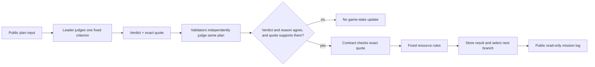

# LastLight

LastLight is a cooperative, three-turn fictional survival game. In v2, each turn gives GenLayer validators one narrow criterion to judge against a player's public plan. The agreed result changes fixed resources and selects a different later emergency with different equipment.

The existing public site and deployed address are the earlier v1 build. LastLight v2 has been implemented locally and is awaiting a new user-signed Studionet deployment and live proof. Do not point the v2 frontend at the old v1 contract; its rules hash must match the v2 mission.

## What v2 adds

- A single `MET`, `NOT_MET`, or `INSUFFICIENT_EVIDENCE` criterion per game transaction.
- A fixed reason code and exact plan excerpt. Validators independently judge the plan and check that the leader's excerpt supports the agreed finding.
- Branching coolant and communications scenes whose equipment and criteria depend on earlier finalized results.
- Deterministic resource changes and scoring; the model never supplies a score or amount.
- 72-hour crew invitation expiry and a permissionless close action.
- A public record view with branch, criterion, verdict, reason, excerpt, plan, and resources. Finalized transaction links appear for locally completed rounds and published proof cases.
- Direct tests, generated source hash, architecture, tutorial, demo script, portal draft, and a read-only live proof verifier.

## Architecture



The browser handles wallet requests, plan entry, and read-only display. The contract owns turn permissions, branching state, judgments, scores, and resources. The evidence is the plan included in the transaction itself; it is immutable after finalization. The evaluator has no need to fetch a web page, and player text is treated as untrusted. The complete boundary and limitations are in [docs/architecture-v2.md](docs/architecture-v2.md).

## Local development

```powershell
python -m venv .venv
.\.venv\Scripts\python.exe -m pip install -r requirements-dev.txt
npm install
npm run generate
npm run dev
```

`content/kestrel-01.json` is the canonical authored mission. `npm run generate` embeds its canonical JSON and SHA-256 hash in the single-file GenLayer contract and frontend. Never edit generated files directly. The contract pins `py-genlayer:1jb45aa8ynh2a9c9xn3b7qqh8sm5q93hwfp7jqmwsfhh8jpz09h6`; no `test` or `latest` runner alias is used.

## Checks

```powershell
npm run check:content
npm test
npm run build
$env:GENVM_VERSION = 'v0.2.16'
.\.venv\Scripts\genvm-lint.exe check contracts\lastlight.py --json
npm run verify:proof
```

The direct tests use mocked model responses. They cover input validation, quotes, all verdict effects, branch transitions, retries, duo turns, and invitation expiry; they do not prove live validator agreement or prompt-injection behavior. The linter needs the cached GenVM runner bundle matching the pinned dependency.

## Live deployment and proof

Current v1 deployment: `0xD5682Ee05Fa8E86fd462b2c2fCB1c7d4e716B8db` on chain 61999. Its old rules hash and two previously completed v1 missions remain historical v1 evidence only. They are not v2 proof.

V2 mission hash: `c67e02a7c9c5e43a474f16d1559b73ca7a59c1cf9622dab014fdb5e135b3fd74`. All game writes attach 0 GEN; wallet network fees may still apply. A human reviews and signs every wallet transaction.

V2 Studionet deployment: `0x8C8779A657BDb2c8c6179d6f47d63A852801919a` ([official explorer](https://explorer-studio.genlayer.com/address/0x8C8779A657BDb2c8c6179d6f47d63A852801919a)). The live test suite has a positive solo rescue and a second solo case that includes an unsafe-order prompt injection and reaches the emergency-transmitter ending. Their finalized results and transaction hashes are recorded in `deploy/proof.json`. The proof verifier checks the pinned public contract source against the local file, all transaction finality, deployed configuration, session state, round verdicts, quotes, and branch identifiers. The app uses the published round hashes to show official explorer links to reviewers without a wallet. The current case set does not include a duo test. The Vercel production URL still points at the earlier v1 frontend until a v2 frontend preview is published.

## Reviewer material

- [Architecture and trust boundary](docs/architecture-v2.md)
- [Step-by-step implementation tutorial](docs/tutorial-v2.md)
- [Two-minute live demo script](docs/demo-v2.md)
- [Portal milestone draft](docs/milestone-v2-portal-copy.md)

The game evaluates fictional player plans. Quotes prove what the plan said, not that a real-world repair occurred. It uses no user funds, escrow, token, or reward.
