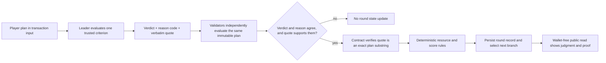

# LastLight v2 architecture

## Contract boundary

The browser collects the player's public plan, displays the selected branch, and reads finalized session records. The LastLight contract stores the rules hash, turn order, branch identifier, plan, one criterion, validator judgment, evidence excerpt, fixed resource changes, and ending. It owns the only authoritative result. There is no backend, token, escrow, or external evidence source.

## Judgment rule

Each `submit_plan` transaction judges one criterion from the branch selected by the previous finalized result. The leader returns a strict JSON object with only `verdict`, `quote`, and `reason_code`. A verdict is `MET`, `NOT_MET`, or `INSUFFICIENT_EVIDENCE`. The quote must be an exact, case-sensitive substring of the plan. Validators independently repeat the narrow evaluation against the same transaction input and must agree on verdict and reason code. They separately assess whether the leader's excerpt itself supports that agreed finding; a merely present but irrelevant excerpt is rejected. The contract rejects malformed outputs and never accepts a model-provided score.

The plan is immutable calldata once the transaction is finalized. It is the evidence being judged; no web fetch or participant-controlled URL is involved. The evaluator treats the plan as untrusted text, ignores instructions inside it, and has no web or tool access. This keeps the input stable and makes source reachability unnecessary.

## Deterministic branches and consequences

The first intake verdict selects `steady_flow` or `pressure_alarm`. The first path opens the powered coolant locker and patch kit. The second blocks that locker and exposes a manual clamp instead. A `MET` coolant judgment powers the main communications relay; other outcomes select the battery emergency transmitter. The third scene therefore differs in facts, equipment, and criterion based on earlier finalized decisions.

Contract code maps each verdict to fixed oxygen, power, and hull changes. Resource values are clamped to 0–100. Reaching zero ends the mission. Only three `MET` judgments produce `RESCUED`; a successful final transmission after earlier setbacks produces `DISTRESS_SENT`; other completed runs end `HOLDING_ON`. The score uses only the resulting resources and count of `MET` outcomes.

## Recovery and limits

Every wallet write is 0 GEN plus any network fee. A two-person invitation expires after 72 hours and may then be closed by anyone; its host may cancel it sooner. Active missions can be abandoned by a crew member. The client stores a pending transaction hash before waiting and can recheck finality after reload. A completed round links to its explorer transaction when the hash is saved locally or published in the proof manifest.

This is a fictional decision game. A quote shows what a player wrote; it does not prove that a physical repair happened. Direct tests use mocked model responses and only exercise the leader path. They do not prove live validator agreement, prompt-injection resistance on Studionet, or end-to-end wallet finality. Those claims require the public proof manifest to be populated from real finalized transactions.
